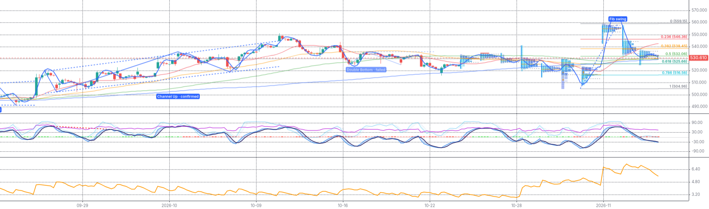

# chartgen

[](https://github.com/5queezer/chartgen/actions/workflows/ci.yml)
[](https://5queezer.github.io/chartgen/)

Chart generator, web app and MCP server for Yahoo Finance and Binance data, written in Rust.



- Web app at [chartgen.vasudev.xyz](https://chartgen.vasudev.xyz/), served from the same origin as the MCP endpoint: a TradingView-style chart with drawing tools, alerts, watchlists, multi-chart layouts, bar replay and a workspace that follows a signed-in user across devices.
- MCP server over stdio or HTTP (`/mcp`, OAuth 2.1 PKCE) for Claude Desktop and Claude.ai. An agent can draw on a chart with the web app's drawing tools and hand over a link that opens them in the web app.
- PNG candlestick charts with 70+ indicators, from Yahoo Finance and Binance.
- Live engine (`--trade`) with a Binance WebSocket feed, alerts and order tools. Orders are only recorded locally; nothing is sent to an exchange.

## Install

Needs Rust 1.89 or newer, `pkg-config`, OpenSSL and the fontconfig and freetype development libraries.

```bash
sudo apt-get install pkg-config libssl-dev libfontconfig1-dev libfreetype-dev  # Debian/Ubuntu
git clone https://github.com/5queezer/chartgen.git && cd chartgen
cargo build --release
```

Or use the Docker image (`docker build -t chartgen .`) or a [release binary](https://github.com/5queezer/chartgen/releases).

## Usage

```bash
chartgen --symbol AAPL --interval 1d -p ema_stack -p rsi -p macd -o chart.png   # PNG chart
chartgen --mcp                      # MCP over stdio (Claude Desktop)
chartgen --serve                    # HTTP server on :9315 (MCP, OAuth)
chartgen --trade --testnet          # same server plus the live engine
```

`--trade` includes the HTTP server, so do not combine it with `--serve`. All flags are in the [CLI reference](https://5queezer.github.io/chartgen/reference/cli/).

### Notification retention

`--trade` reads optional `~/.chartgen/config.toml` before starting its feed. With no
file, notifications expire after 3600 seconds and each subscription queues at most
1000 offline notifications. Either setting may be overridden:

```toml
notification_ttl_secs = 7_200 # two hours
max_queue_size = 1_500       # entries per subscription
```

The supported TOML subset is these two bare root keys with positive decimal
integers, optional `+`, digit separators, whitespace and `#` comments. Omitted keys
keep their defaults. Values must fit a signed 64-bit integer; queue size must also
fit the platform's `usize`. Zero, malformed values, duplicate or unknown keys,
tables and other unsupported syntax fail startup with the file path and line
number (exit status 2). Read errors also fail startup; a missing file uses defaults.
Rendering, stdio MCP and `--serve` without a trading engine do not read this file.

Triggered notifications include the engine's canonical interval, including when
delivered from an offline queue after reconnecting. Existing saved alerts continue
to load without an interval field.

### PNG presentation

Legends have opaque backgrounds; axes use fewer ticks on short panels and compact
K/M/B numbers. Profile levels show their names and prices, and profile histograms
sit behind candles. SAR uses per-bar dots, Donchian/pivot levels use stairs, and
VWAP connectors stop at session resets while numeric series retain every value.
Candlestick labels include direction (`+` bullish, `-` bearish) and a visible name
key; `BH` means Belt Hold.

The `heikin_ashi` indicator overlays a directional HA close/open ribbon on the
original candles. To replace the price candles themselves, use the MCP
`chart_style=heikin_ashi` option instead. The existing HA close remains numeric
plot zero. Optional presentation metadata preserves existing numeric channels and
is consumed by the browser adapters.

Offline readability fixtures can be regenerated with
`cargo run --example readability -- path/to/pngs`. They use fixed synthetic bars
and timestamps, without market-data requests.

## Documentation

- [Quick start](https://5queezer.github.io/chartgen/guides/quickstart/) and [CLI reference](https://5queezer.github.io/chartgen/reference/cli/)
- [Indicators](https://5queezer.github.io/chartgen/reference/indicators/)
- [MCP integration](https://5queezer.github.io/chartgen/reference/mcp/) and [OAuth](https://5queezer.github.io/chartgen/reference/oauth/)
- [Web app](https://5queezer.github.io/chartgen/guides/web/)
- [Deployment](https://5queezer.github.io/chartgen/guides/deploy/) and [testing](https://5queezer.github.io/chartgen/guides/testing/)
- [Architecture decisions](https://5queezer.github.io/chartgen/decisions/)

## Contributing

See the [contributing guide](https://5queezer.github.io/chartgen/guides/contributing/).

## License

[MIT](LICENSE)
