<!-- Generated by `cargo run --example gen_docs`. Do not edit by hand. -->

Indicators live in three buckets in the registry (`src/indicators/mod.rs`):

- **Overlays** draw on the price chart (bands, clouds, volume profiles).
- **Panels** render as separate rows below the price chart (oscillators, volume).
- **External** pull from third-party APIs (Binance derivatives, alternative.me).

Every name and every alias below is accepted by the CLI (`-p <name>`) and by
the `generate_chart` MCP tool's `indicators` parameter. Screenshots are
rendered from `AAPL` daily data (overlays and panels) and `BTCUSDT` daily
data (external) — regenerate with `./scripts/gen_screenshots.sh`.

## Values match TradingView

Indicator math follows Pine Script v5 semantics, implemented once in
`src/indicators/pine.rs` ([ADR-0018](/chartgen/decisions/0018-pine-semantics-for-indicators/)).
`ta.ema` and `ta.rma` seed with the SMA of the first `length` values. RSI, ATR
and DMI/ADX use Wilder's RMA. Bollinger Bands use the population standard
deviation. Defaults are TradingView's. Bars before an indicator has seen
`length` valid values are `null` (NaN), not partial values. With the same
parameters and the same first bar, the values equal TradingView's built-ins.
The community composites (`cipher_b`, `wavetrend`, `rsi_mfi_stoch`,
`kalman_volume`) follow the Pine semantics of the `ta.*` calls in the scripts
they port.

Missing values (`na`) follow the Pine reference. Window functions (`sma`,
`sum`, `stdev`, `highest`, `lowest`, ...) skip them and use the last `length`
valid values, so a flat stochastic or a zero-range bar leaves no gap. EMA and
RMA keep their state across a missing value and repeat the previous value;
that case is not yet verified against a live TradingView chart.

EMA and RMA are recursive, so a value depends on where the series starts.
Load enough history before the bars you compare (`warmup` in series mode)
so the start-up effect has decayed. A non-zero `warmup` is raised to what
the EMA- and RMA-based built-ins need to converge, from their parameters, up
to 1000 bars ([ADR-0032](/chartgen/decisions/0032-indicator-aware-warmup/));
the community composites and user scripts keep the `warmup` you send. Known differences:

- **WaveTrend lengths.** `wavetrend` is the WaveTrend inside VuManChu Cipher B
  and keeps its lengths 9 / 12 / 3 (LazyBear's script: 10 / 21 / 4).
- **Calendar periods.** `vwap` / `vwap_bands` anchors and `pivot` periods
  are UTC days, ISO weeks, months and years of the bar times. TradingView
  uses the exchange session and time zone, which can differ for non-UTC
  markets. On daily and higher charts the `session` anchor resets on every
  bar, as TradingView's `timeframe.change("D")` does. Without bar timestamps
  VWAP never resets and pivots stay empty.
- **Pivots.** The higher-timeframe high / low / close comes from the loaded
  chart bars. Every period is drawn (TradingView shows the last 15), and only
  P, R1, S1, R2 and S2.
- **Ichimoku.** The leading spans are shifted `displacement - 1` bars forward,
  and the lagging span the same distance back. The cloud projected past the
  last bar is not drawn yet.
- **Intrabar data.** The volume profiles (`volume_profile`, `session_vp`,
  `hvn_lvn`, `naked_poc`, `tpo`) and `cvd` spread each bar's volume over its
  range. TradingView builds them from lower-timeframe data, so they are
  approximations.
- **Long warmups.** `kalman_volume` normalises by a 200-bar standard deviation
  and needs about 280 bars before its first value.
- **Unknown timeframe.** `histvol` needs the timeframe to annualize. When it
  is unknown, the line stays empty.

## Overlays

### Summary

| Name | Aliases |
|------|---------|
| [`ema_stack`](#ema_stack) | `ema` |
| [`bbands`](#bbands) | `bollinger` |
| [`keltner`](#keltner) |  |
| [`donchian`](#donchian) |  |
| [`vwap`](#vwap) |  |
| [`vwap_bands`](#vwap_bands) |  |
| [`supertrend`](#supertrend) |  |
| [`sar`](#sar) | `parabolic_sar` |
| [`ichimoku`](#ichimoku) |  |
| [`heikin_ashi`](#heikin_ashi) | `ha` |
| [`pivot`](#pivot) | `pivot_points` |
| [`volume_profile`](#volume_profile) | `vp`, `vpvr` |
| [`session_vp`](#session_vp) | `svp`, `session_volume_profile` |
| [`hvn_lvn`](#hvn_lvn) | `vp_nodes`, `volume_nodes` |
| [`naked_poc`](#naked_poc) | `npoc` |
| [`tpo`](#tpo) | `market_profile` |
| [`ma`](#ma) |  |
| [`vwma`](#vwma) |  |
| [`hma`](#hma) |  |
| [`ma_ribbon`](#ma_ribbon) |  |
| [`envelopes`](#envelopes) |  |
| [`linreg_channel`](#linreg_channel) |  |
| [`chande_kroll_stop`](#chande_kroll_stop) |  |
| [`zigzag`](#zigzag) |  |

### `ema_stack`

EMA Stack — 4 exponential moving averages (8/21/50/200)

**Aliases:** `ema`

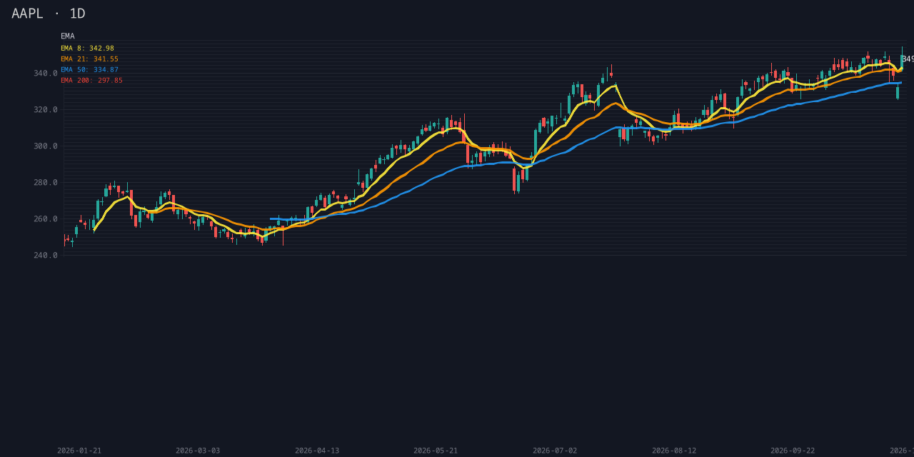

### `bbands`

Bollinger Bands — volatility bands around SMA

**Aliases:** `bollinger`

**Parameters:**

| Param | Type | Default | Description |
|-------|------|---------|-------------|
| `period` | `integer` | `20` |  |
| `std_dev` | `number` | `2.0` |  |

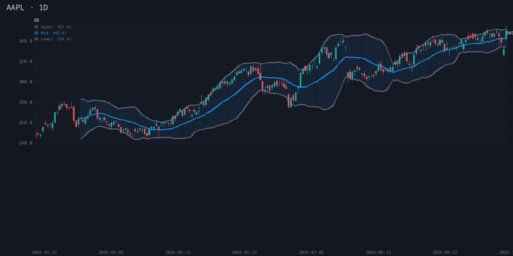

### `keltner`

Keltner Channels — ATR-based volatility bands

**Parameters:**

| Param | Type | Default | Description |
|-------|------|---------|-------------|
| `period` | `integer` | `20` |  |
| `multiplier` | `number` | `2.0` |  |
| `atr_length` | `integer` | `10` | ATR length for the band width |

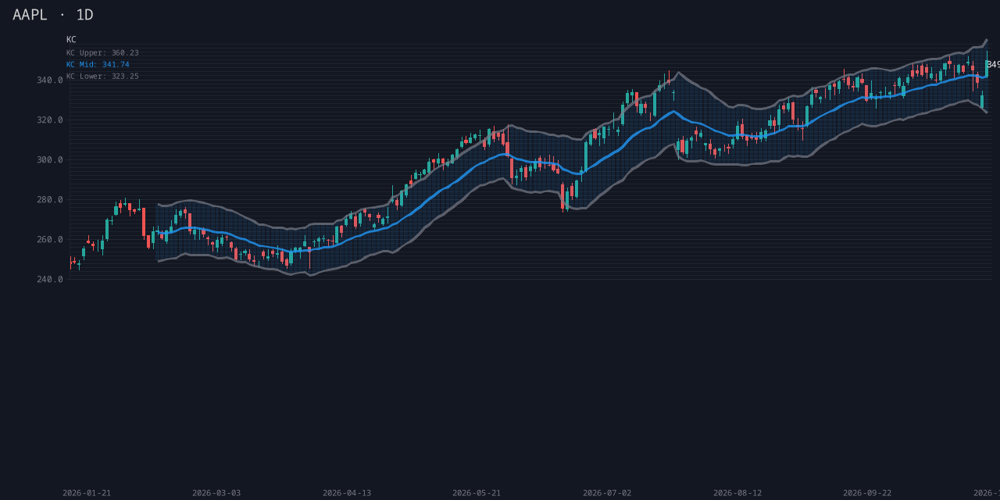

### `donchian`

Donchian Channels — breakout trading bands

**Parameters:**

| Param | Type | Default | Description |
|-------|------|---------|-------------|
| `period` | `integer` | `20` |  |

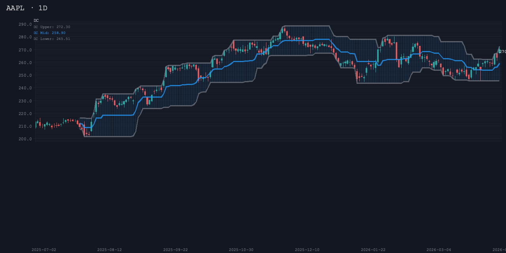

### `vwap`

Volume Weighted Average Price — anchored to the session, week or month

**Parameters:**

| Param | Type | Default | Description |
|-------|------|---------|-------------|
| `anchor` | `string` | `session` | Reset period: UTC day (session), ISO week, calendar month, or never |

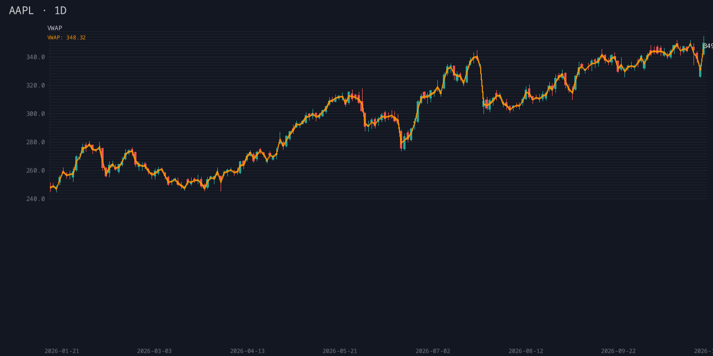

### `vwap_bands`

VWAP Bands — standard deviation bands around VWAP

**Parameters:**

| Param | Type | Default | Description |
|-------|------|---------|-------------|
| `std_dev` | `number` | `1.0` |  |
| `anchor` | `string` | `session` | Reset period: UTC day (session), ISO week, calendar month, or never |

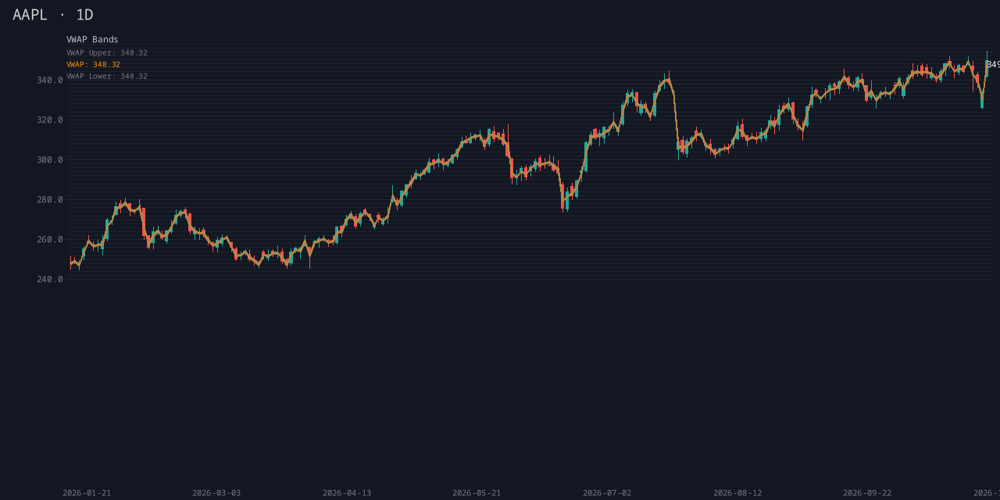

### `supertrend`

Supertrend — ATR-based trend follower (Up Trend / Down Trend lines that break at a flip)

**Parameters:**

| Param | Type | Default | Description |
|-------|------|---------|-------------|
| `period` | `integer` | `10` |  |
| `multiplier` | `number` | `3.0` |  |

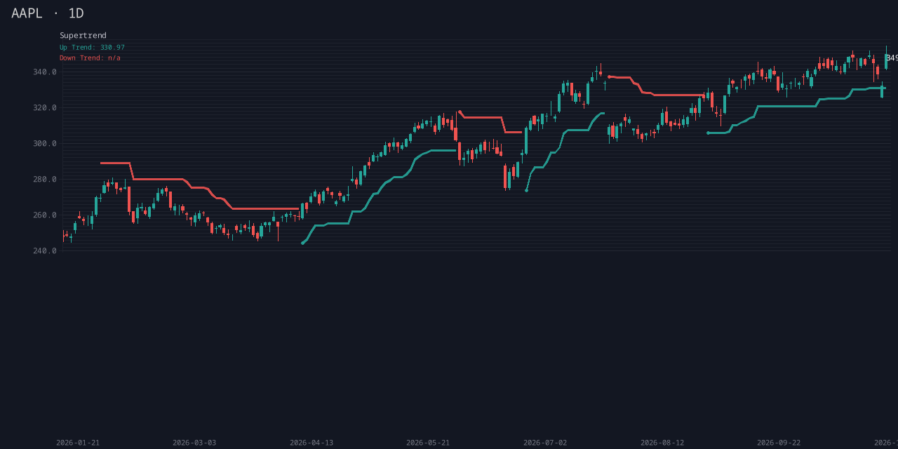

### `sar`

Parabolic SAR — trailing stop / trend reversal

**Aliases:** `parabolic_sar`

**Parameters:**

| Param | Type | Default | Description |
|-------|------|---------|-------------|
| `af_start` | `number` | `0.02` |  |
| `af_step` | `number` | `0.02` |  |
| `af_max` | `number` | `0.2` |  |

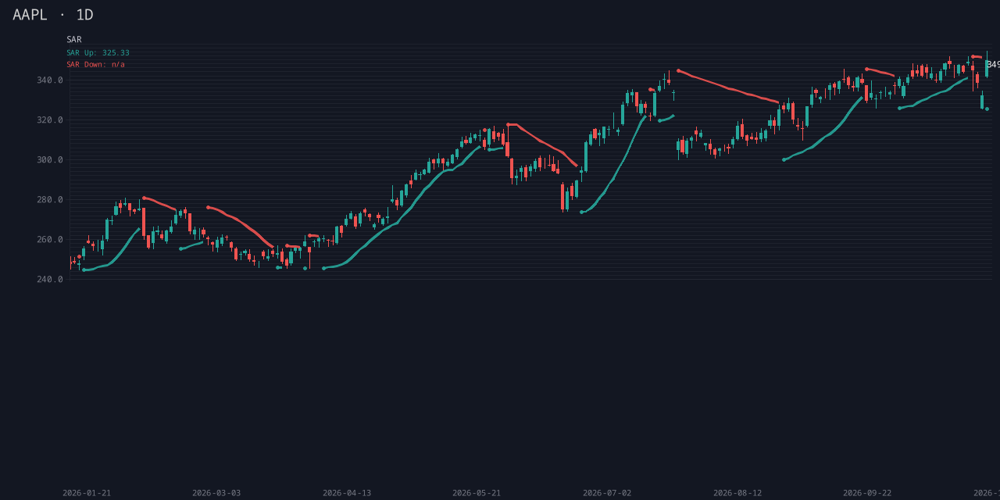

### `ichimoku`

Ichimoku Cloud — trend, support/resistance, momentum

**Parameters:**

| Param | Type | Default | Description |
|-------|------|---------|-------------|
| `tenkan` | `integer` | `9` |  |
| `kijun` | `integer` | `26` |  |
| `senkou_b` | `integer` | `52` |  |
| `displacement` | `integer` | `26` | Leading spans are drawn displacement - 1 bars ahead, the lagging span (close) as many bars back |

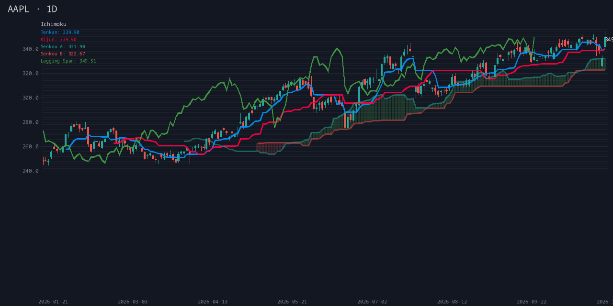

### `heikin_ashi`

Heikin Ashi — smoothed trend candles

**Aliases:** `ha`

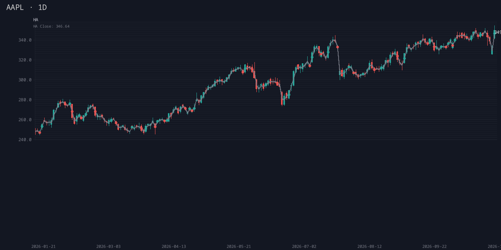

### `pivot`

Pivot Points Standard (Traditional) — levels from the previous higher-timeframe period

**Aliases:** `pivot_points`

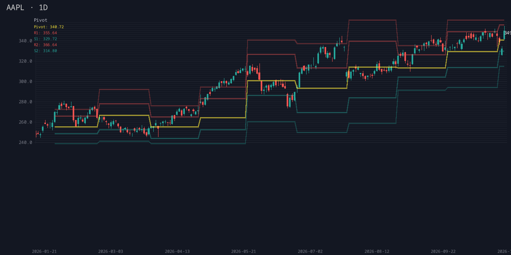

### `volume_profile`

Volume Profile Visible Range — horizontal volume histogram with POC/VAH/VAL

**Aliases:** `vp`, `vpvr`

**Parameters:**

| Param | Type | Default | Description |
|-------|------|---------|-------------|
| `bins` | `integer` | `24` |  |
| `side` | `string` | `left` | left or right |
| `range_bars` | `integer` | `null` | only compute over last N bars (null = all) |
| `split_up_down` | `boolean` | `false` | separate up/down volume colors |
| `color_up` | `string` | `#26a69a` | hex color for up-volume |
| `color_down` | `string` | `#ef5350` | hex color for down-volume |
| `opacity` | `number` | `0.35` | overall opacity multiplier (0.0-1.0) |

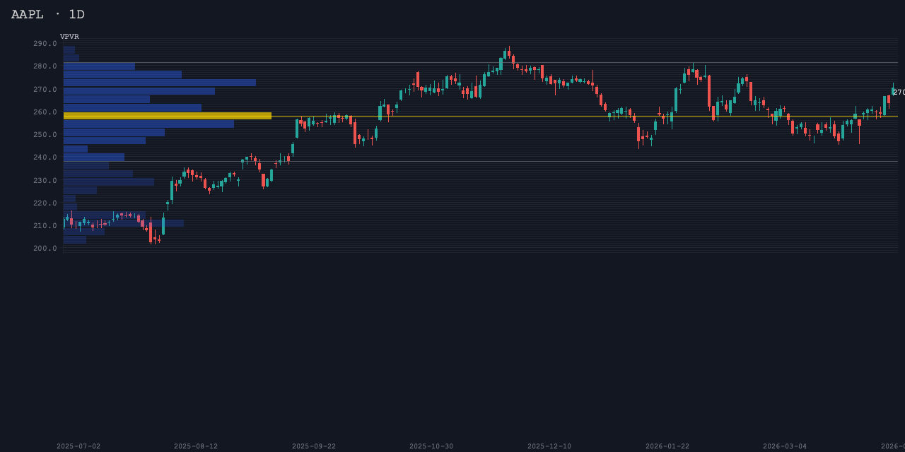

### `session_vp`

Session Volume Profile — per-session POC/VAH/VAL that reset each day/week

**Aliases:** `svp`, `session_volume_profile`

**Parameters:**

| Param | Type | Default | Description |
|-------|------|---------|-------------|
| `bins` | `integer` | `24` |  |
| `session` | `string` | `daily` | daily, weekly, or hourly |
| `bars_per_session` | `integer` | `null` | override session by fixed bar count |
| `show_value_area` | `boolean` | `true` | draw VAH/VAL in addition to POC |

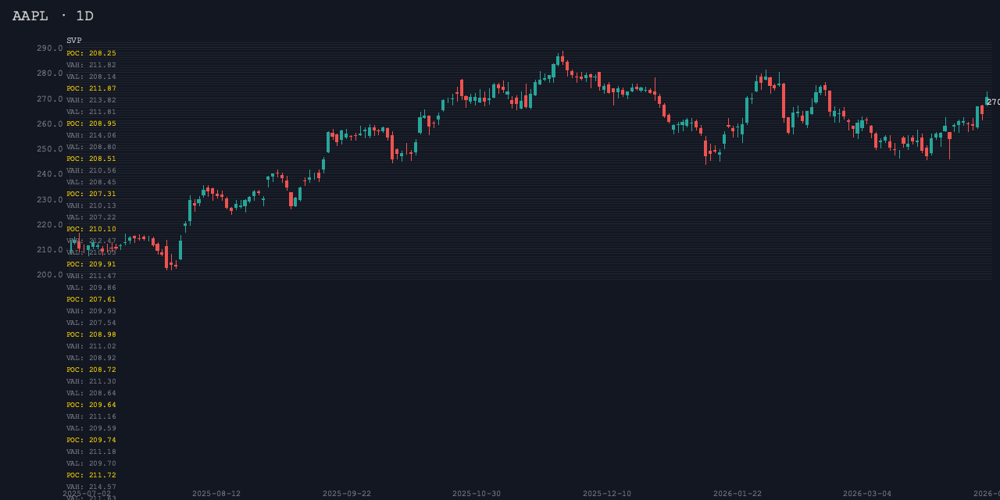

### `hvn_lvn`

High/Low Volume Nodes — auto-detected support/resistance from the volume profile

**Aliases:** `vp_nodes`, `volume_nodes`

**Parameters:**

| Param | Type | Default | Description |
|-------|------|---------|-------------|
| `bins` | `integer` | `48` |  |
| `range_bars` | `integer` | `null` | only scan the last N bars (null = all) |
| `neighborhood` | `integer` | `2` | bins on each side to compare for local extrema |
| `min_prominence` | `number` | `0.1` | minimum relative prominence (0-1) vs max bin |
| `top_n` | `integer` | `null` | keep only the N strongest nodes of each kind |
| `show_hvn` | `boolean` | `true` |  |
| `show_lvn` | `boolean` | `true` |  |

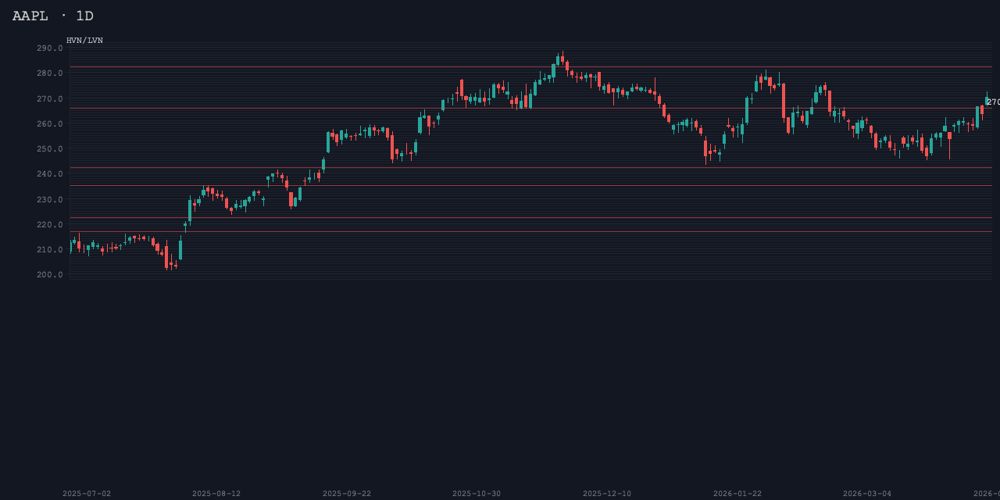

### `naked_poc`

Naked POCs — unfilled point-of-control levels from previous sessions

**Aliases:** `npoc`

**Parameters:**

| Param | Type | Default | Description |
|-------|------|---------|-------------|
| `bins` | `integer` | `24` |  |
| `session` | `string` | `daily` | daily, weekly, hourly |
| `bars_per_session` | `integer` | `null` |  |
| `max_sessions` | `integer` | `20` | look back at most N sessions |
| `include_current` | `boolean` | `true` | also draw the developing POC of the current session |

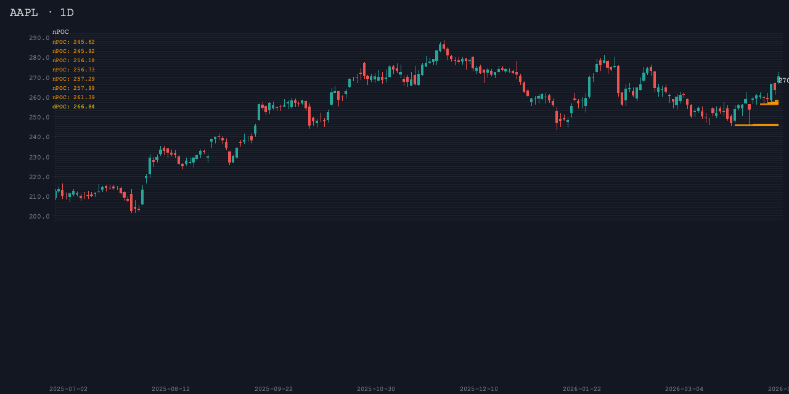

### `tpo`

Time Price Opportunity — time-based market profile with POC/VAH/VAL

**Aliases:** `market_profile`

**Parameters:**

| Param | Type | Default | Description |
|-------|------|---------|-------------|
| `bins` | `integer` | `32` |  |
| `side` | `string` | `right` | left or right |
| `range_bars` | `integer` | `null` | only compute over last N bars |
| `opacity` | `number` | `0.35` | bar opacity (0.0-1.0) |

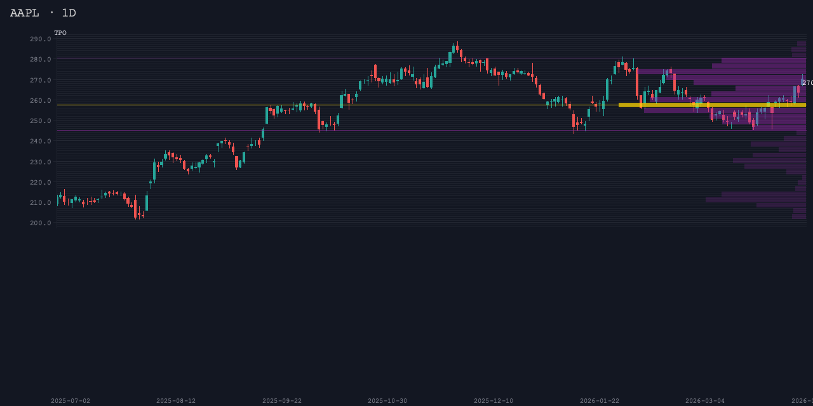

### `ma`

Moving Average (sma, ema, wma, hma, vwma, rma, alma, dema, tema, lsma)

**Parameters:**

| Param | Type | Default | Description |
|-------|------|---------|-------------|
| `type` | `string` | `sma` | Moving average type |
| `length` | `integer` | `9` | MA length |
| `source` | `string` | `close` | Price source |
| `offset` | `integer` | `0` | Shift the line by this many bars (negative = left). Values shifted past the last bar are dropped |

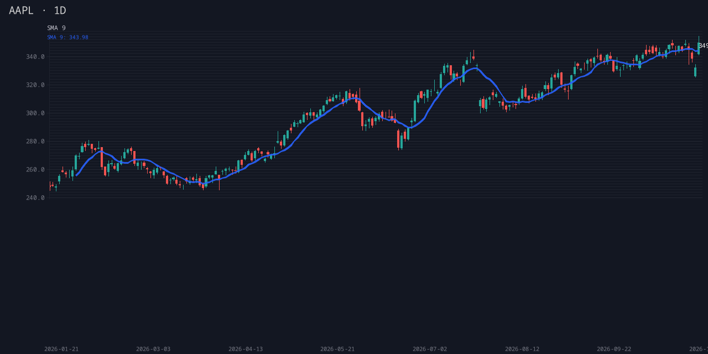

### `vwma`

Volume Weighted Moving Average (ta.vwma)

**Parameters:**

| Param | Type | Default | Description |
|-------|------|---------|-------------|
| `length` | `integer` | `9` | MA length |
| `source` | `string` | `close` | Price source |
| `offset` | `integer` | `0` | Shift the line by this many bars (negative = left). Values shifted past the last bar are dropped |

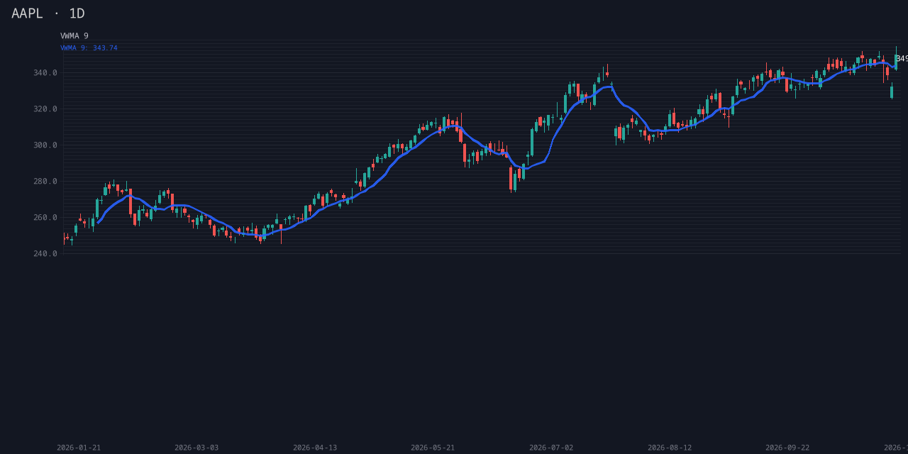

### `hma`

Hull Moving Average (ta.hma)

**Parameters:**

| Param | Type | Default | Description |
|-------|------|---------|-------------|
| `length` | `integer` | `9` | MA length |
| `source` | `string` | `close` | Price source |
| `offset` | `integer` | `0` | Shift the line by this many bars (negative = left). Values shifted past the last bar are dropped |

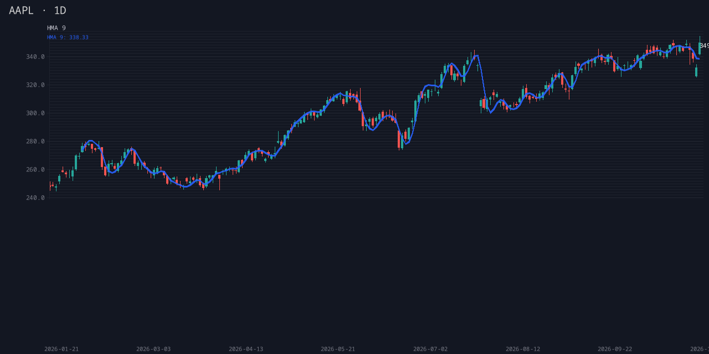

### `ma_ribbon`

Moving Average Ribbon — four moving averages (20/50/100/200 by default)

**Parameters:**

| Param | Type | Default | Description |
|-------|------|---------|-------------|
| `type` | `string` | `sma` | Moving average type |
| `source` | `string` | `close` | Price source |
| `length1` | `integer` | `20` | MA 1 length |
| `length2` | `integer` | `50` | MA 2 length |
| `length3` | `integer` | `100` | MA 3 length |
| `length4` | `integer` | `200` | MA 4 length |

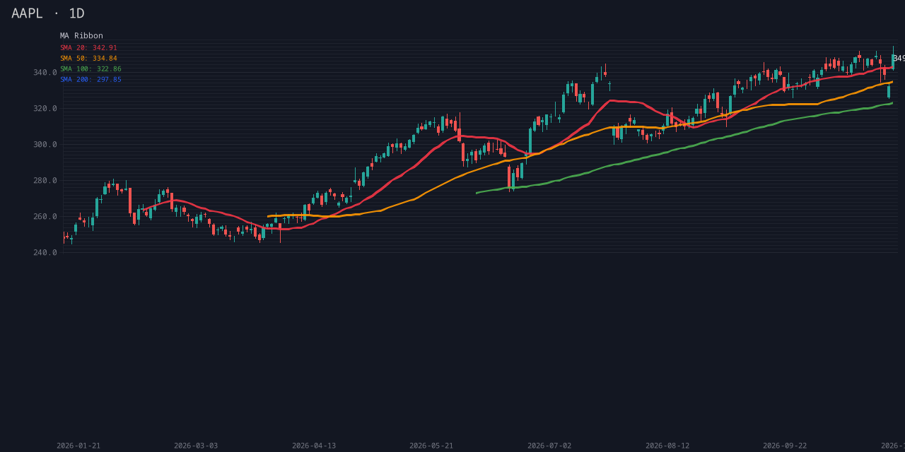

### `envelopes`

Envelopes — moving-average basis with upper/lower bands at a fixed percentage

**Parameters:**

| Param | Type | Default | Description |
|-------|------|---------|-------------|
| `type` | `string` | `sma` | Moving average type |
| `length` | `integer` | `20` | Basis MA length |
| `percent` | `number` | `10.0` | Band distance in percent of the basis |
| `source` | `string` | `close` | Price source |

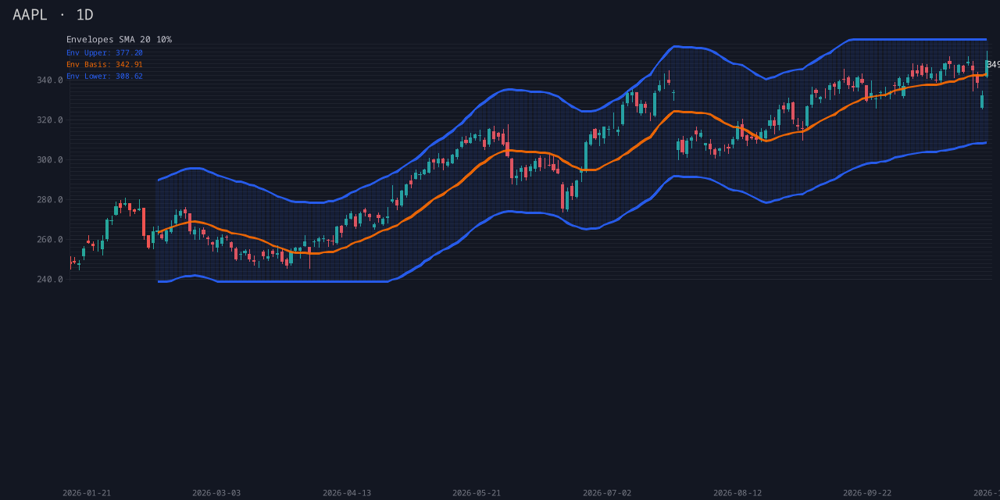

### `linreg_channel`

Linear Regression Channel — regression line over the last N bars with standard-deviation bands

**Parameters:**

| Param | Type | Default | Description |
|-------|------|---------|-------------|
| `length` | `integer` | `100` | Number of bars in the regression (uses fewer if less data) |
| `upper_dev` | `number` | `2.0` | Upper deviation multiplier |
| `lower_dev` | `number` | `2.0` | Lower deviation multiplier |
| `source` | `string` | `close` | Price source |

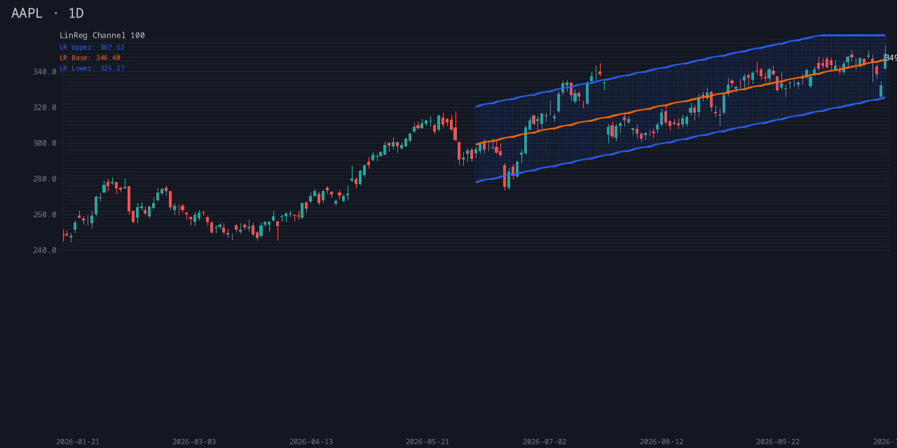

### `chande_kroll_stop`

Chande Kroll Stop — ATR-based long and short trailing stops

**Parameters:**

| Param | Type | Default | Description |
|-------|------|---------|-------------|
| `atr_length` | `integer` | `10` | ATR / first high-low stop length (p) |
| `atr_mult` | `number` | `1.0` | ATR multiplier (x) |
| `stop_length` | `integer` | `9` | Stop smoothing length (q) |

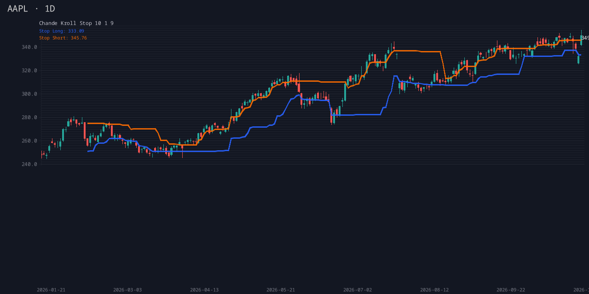

### `zigzag`

ZigZag — connects confirmed swing pivots that differ by at least the deviation %

**Parameters:**

| Param | Type | Default | Description |
|-------|------|---------|-------------|
| `deviation` | `number` | `5.0` | Minimum price change between pivots in percent |
| `depth` | `integer` | `10` | Pivot legs: bars on each side of a swing high/low |

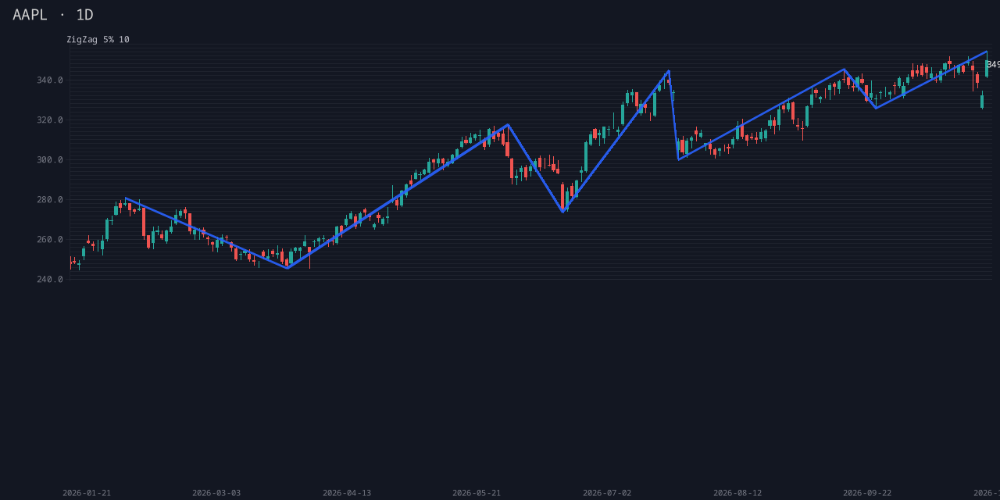

## Panels

### Summary

| Name | Aliases |
|------|---------|
| [`cipher_b`](#cipher_b) |  |
| [`macd`](#macd) |  |
| [`rsi`](#rsi) |  |
| [`wavetrend`](#wavetrend) |  |
| [`stoch`](#stoch) | `stochastic` |
| [`atr`](#atr) |  |
| [`obv`](#obv) |  |
| [`cci`](#cci) |  |
| [`roc`](#roc) |  |
| [`mfi`](#mfi) |  |
| [`williams_r`](#williams_r) | `willr` |
| [`cmf`](#cmf) |  |
| [`adx`](#adx) |  |
| [`ad`](#ad) | `ad_line` |
| [`histvol`](#histvol) | `hv` |
| [`kalman_volume`](#kalman_volume) | `kalman`, `kvf` |
| [`rsi_mfi_stoch`](#rsi_mfi_stoch) | `rsi_combo`, `combo` |
| [`volume`](#volume) |  |
| [`aroon`](#aroon) |  |
| [`vortex`](#vortex) |  |
| [`stoch_rsi`](#stoch_rsi) | `stochrsi` |
| [`awesome_oscillator`](#awesome_oscillator) | `ao` |
| [`momentum`](#momentum) | `mom` |
| [`trix`](#trix) |  |
| [`ultimate_oscillator`](#ultimate_oscillator) | `uo` |
| [`ppo`](#ppo) | `price_oscillator` |
| [`cmo`](#cmo) |  |
| [`dpo`](#dpo) |  |
| [`elder_force_index`](#elder_force_index) | `efi` |
| [`tsi`](#tsi) |  |
| [`kst`](#kst) |  |
| [`coppock`](#coppock) | `coppock_curve` |
| [`mass_index`](#mass_index) | `mi` |
| [`bb_percent_b`](#bb_percent_b) | `percent_b`, `bbp` |
| [`bb_width`](#bb_width) | `bbw`, `bandwidth` |
| [`choppiness`](#choppiness) | `chop` |
| [`fisher_transform`](#fisher_transform) | `fisher` |
| [`ease_of_movement`](#ease_of_movement) | `eom` |
| [`volume_oscillator`](#volume_oscillator) | `vol_osc` |
| [`balance_of_power`](#balance_of_power) | `bop` |
| [`rvi`](#rvi) | `relative_vigor_index` |
| [`smi_ergodic`](#smi_ergodic) | `smi` |
| [`connors_rsi`](#connors_rsi) | `crsi`, `connors` |

### `cipher_b`

Market Cipher B — composite (WaveTrend + divergences + RSI + Stoch RSI + MFI)

**Parameters:**

| Param | Type | Default | Description |
|-------|------|---------|-------------|
| `dot_mode` | `string` | `strict` | classic (WT cross only) or strict (with RSI+StochRSI filter) |
| `wt_channel_length` | `integer` | `9` |  |
| `wt_average_length` | `integer` | `12` |  |
| `wt_oversold` | `number` | `-53` |  |
| `wt_overbought` | `number` | `53` |  |
| `show_divergences` | `boolean` | `true` | render divergence lines on wave trend |

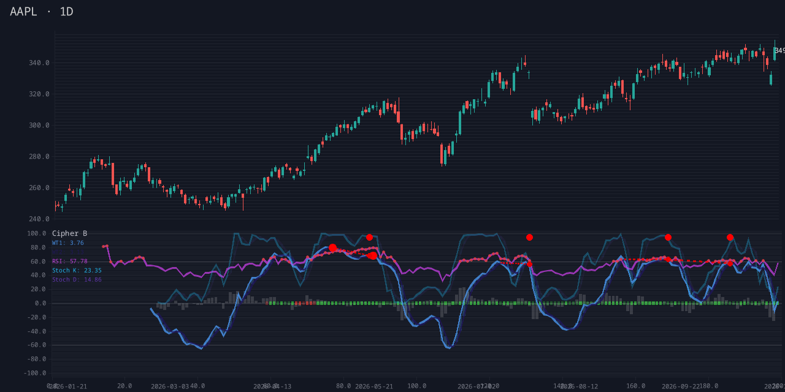

### `macd`

Moving Average Convergence Divergence — trend momentum

**Parameters:**

| Param | Type | Default | Description |
|-------|------|---------|-------------|
| `fast` | `integer` | `12` |  |
| `slow` | `integer` | `26` |  |
| `signal` | `integer` | `9` |  |

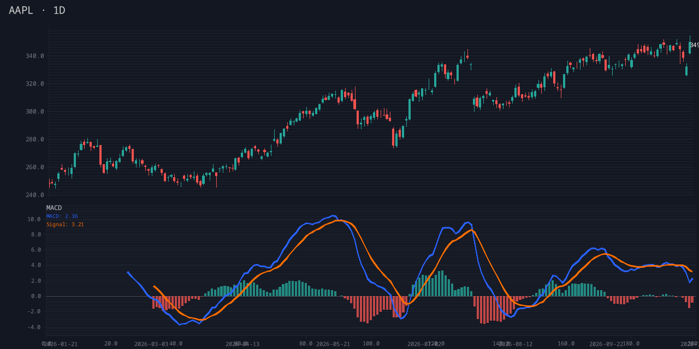

### `rsi`

Relative Strength Index — momentum oscillator (0-100)

**Parameters:**

| Param | Type | Default | Description |
|-------|------|---------|-------------|
| `length` | `integer` | `14` | RSI period |

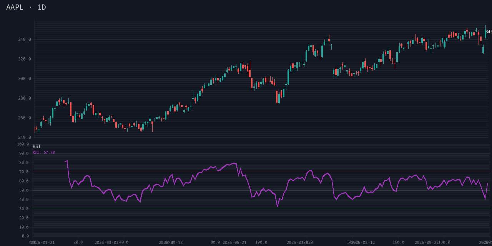

### `wavetrend`

WaveTrend Oscillator — cycle-based momentum

**Parameters:**

| Param | Type | Default | Description |
|-------|------|---------|-------------|
| `ch_len` | `integer` | `9` |  |
| `avg_len` | `integer` | `12` |  |

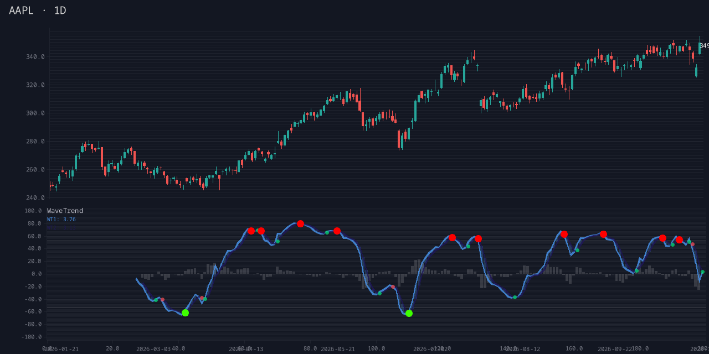

### `stoch`

Slow Stochastic — overbought/oversold oscillator

**Aliases:** `stochastic`

**Parameters:**

| Param | Type | Default | Description |
|-------|------|---------|-------------|
| `period` | `integer` | `14` |  |
| `k_smooth` | `integer` | `1` |  |
| `d_smooth` | `integer` | `3` |  |

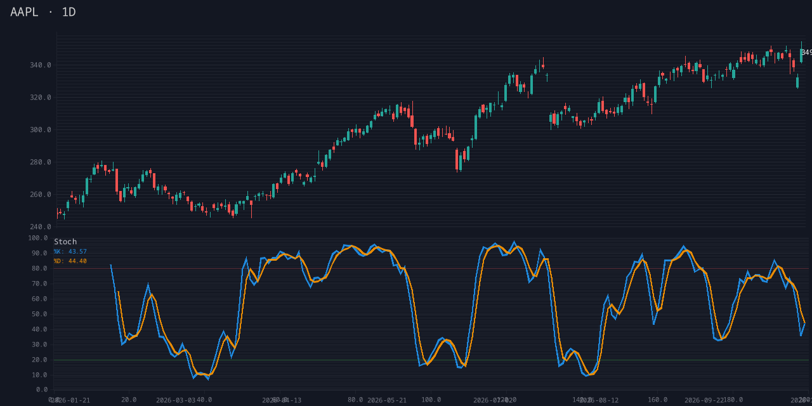

### `atr`

Average True Range — volatility measure

**Parameters:**

| Param | Type | Default | Description |
|-------|------|---------|-------------|
| `period` | `integer` | `14` |  |

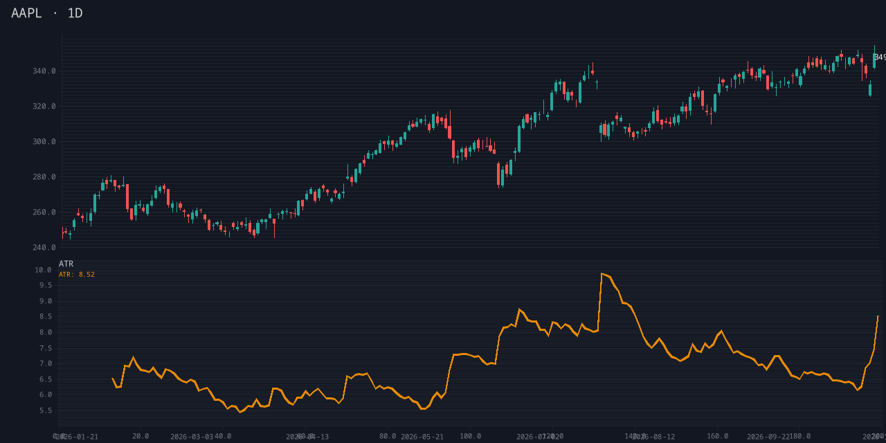

### `obv`

On-Balance Volume — cumulative volume flow

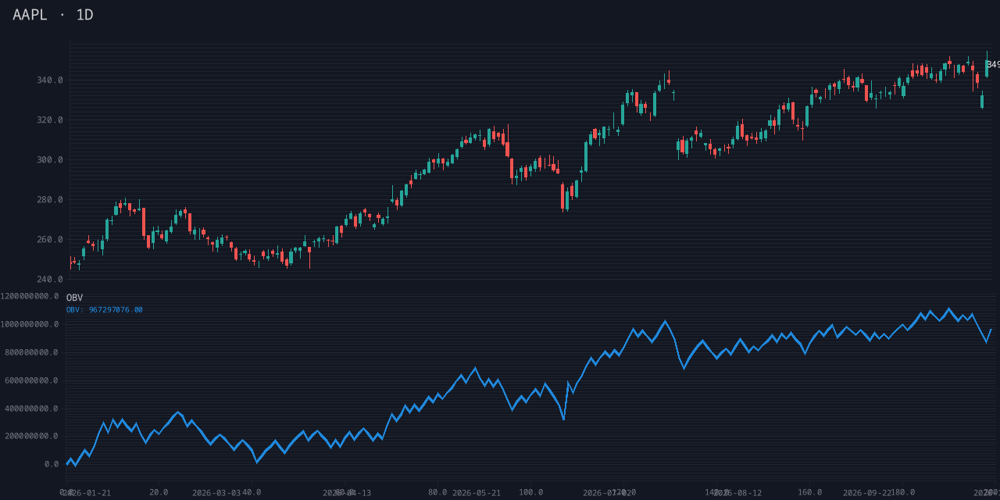

### `cci`

Commodity Channel Index — cyclical momentum

**Parameters:**

| Param | Type | Default | Description |
|-------|------|---------|-------------|
| `period` | `integer` | `20` |  |

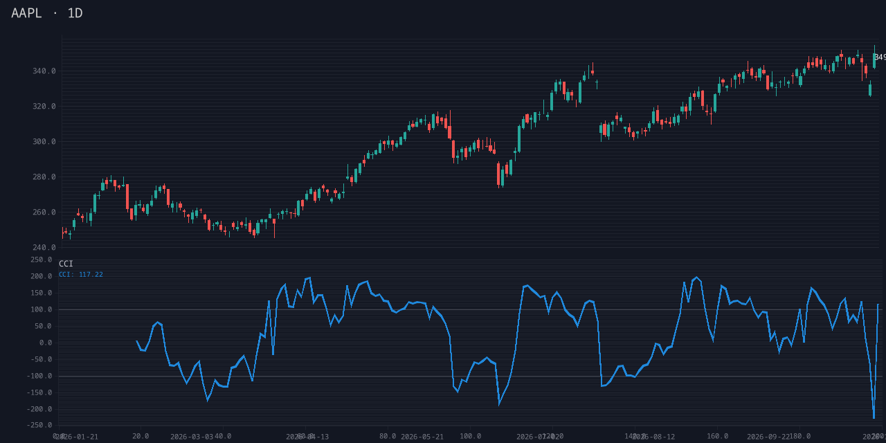

### `roc`

Rate of Change — momentum percentage

**Parameters:**

| Param | Type | Default | Description |
|-------|------|---------|-------------|
| `period` | `integer` | `9` |  |

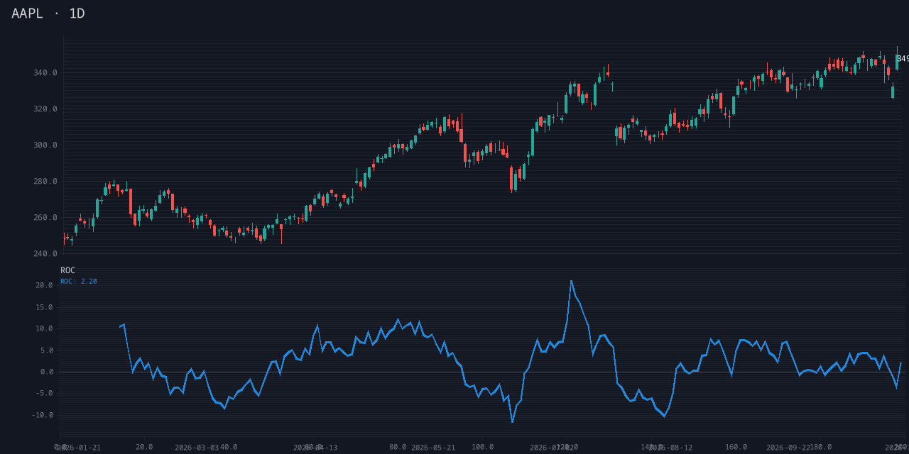

### `mfi`

Money Flow Index — volume-weighted RSI

**Parameters:**

| Param | Type | Default | Description |
|-------|------|---------|-------------|
| `period` | `integer` | `14` |  |

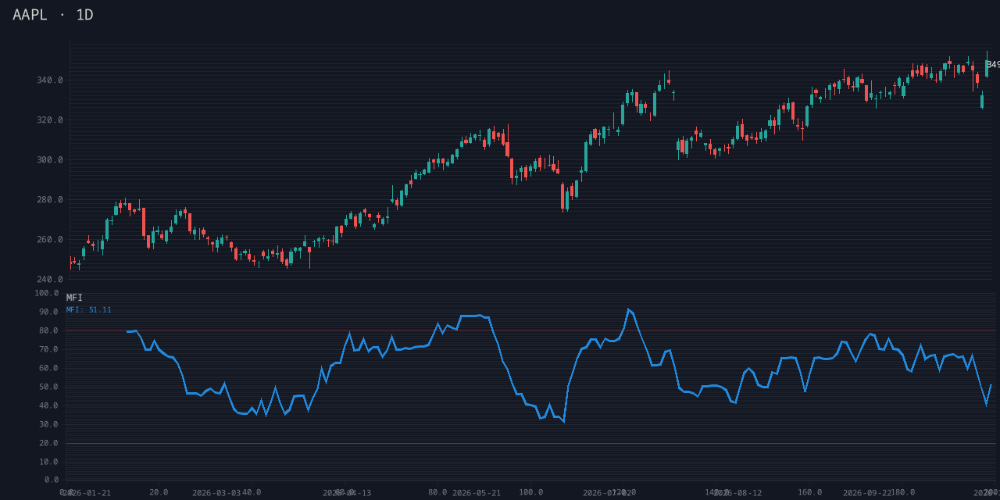

### `williams_r`

Williams %R — momentum reversal indicator

**Aliases:** `willr`

**Parameters:**

| Param | Type | Default | Description |
|-------|------|---------|-------------|
| `period` | `integer` | `14` |  |

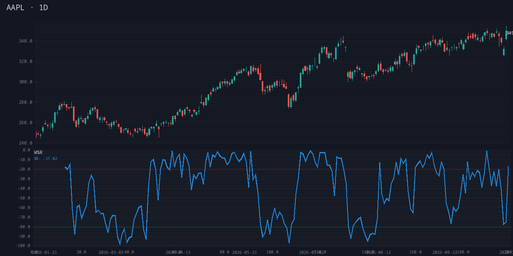

### `cmf`

Chaikin Money Flow — buying/selling pressure

**Parameters:**

| Param | Type | Default | Description |
|-------|------|---------|-------------|
| `period` | `integer` | `20` |  |

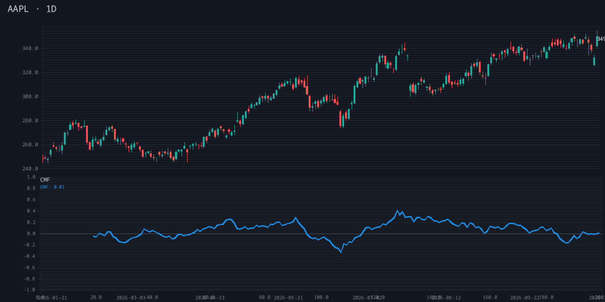

### `adx`

Average Directional Index — trend strength with +DI/-DI

**Parameters:**

| Param | Type | Default | Description |
|-------|------|---------|-------------|
| `period` | `integer` | `14` |  |

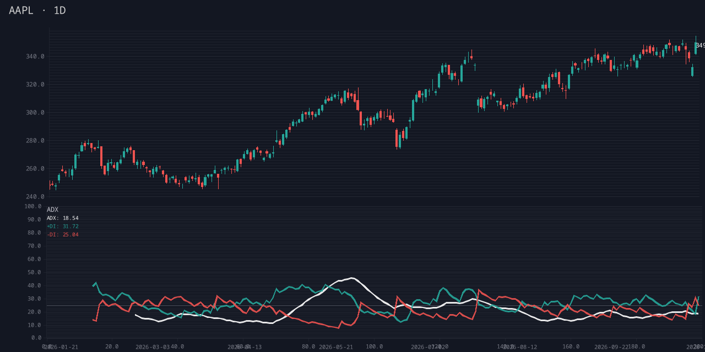

### `ad`

Accumulation/Distribution Line — volume flow

**Aliases:** `ad_line`

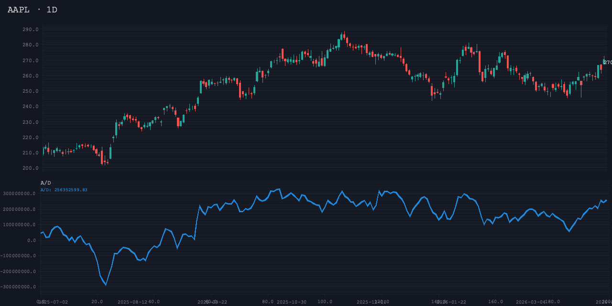

### `histvol`

Historical Volatility — annualized log-return std dev

**Aliases:** `hv`

**Parameters:**

| Param | Type | Default | Description |
|-------|------|---------|-------------|
| `period` | `integer` | `10` |  |

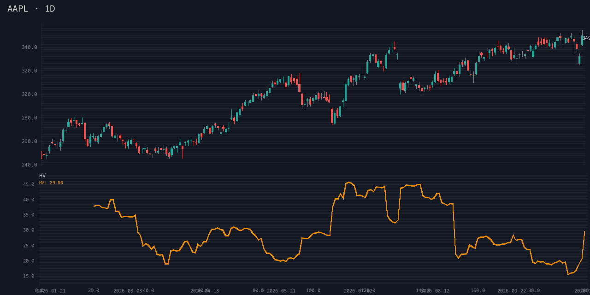

### `kalman_volume`

Kalman Volume Filter — smoothed volume zone oscillator

**Aliases:** `kalman`, `kvf`

**Parameters:**

| Param | Type | Default | Description |
|-------|------|---------|-------------|
| `vzo_length` | `integer` | `70` |  |
| `k` | `number` | `0.06` |  |
| `sig_length` | `integer` | `10` |  |

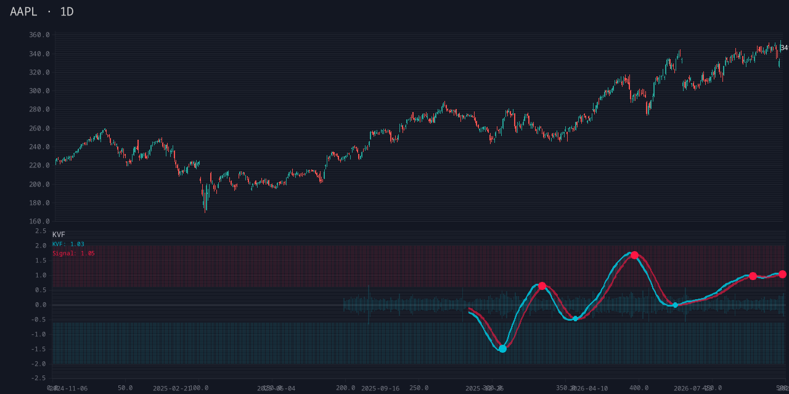

### `rsi_mfi_stoch`

RSI + Money Flow Index + Stochastic combo panel (all 0-100)

**Aliases:** `rsi_combo`, `combo`

**Parameters:**

| Param | Type | Default | Description |
|-------|------|---------|-------------|
| `rsi_length` | `integer` | `14` |  |
| `mfi_length` | `integer` | `14` |  |
| `stoch_k` | `integer` | `14` |  |
| `stoch_d` | `integer` | `3` |  |
| `stoch_smooth` | `integer` | `3` |  |
| `overbought` | `number` | `70` |  |
| `oversold` | `number` | `30` |  |
| `show_entry_dots` | `boolean` | `true` |  |
| `show_trend_bars` | `boolean` | `true` |  |

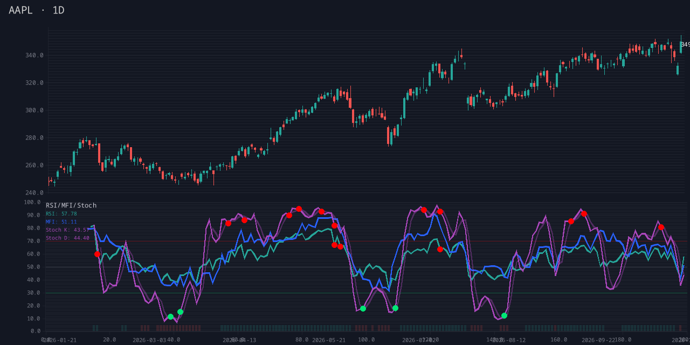

### `volume`

Volume histogram colored by candle direction, with optional volume MA (TradingView Volume)

**Parameters:**

| Param | Type | Default | Description |
|-------|------|---------|-------------|
| `ma_length` | `integer` | `20` | Volume SMA length (0 = off) |

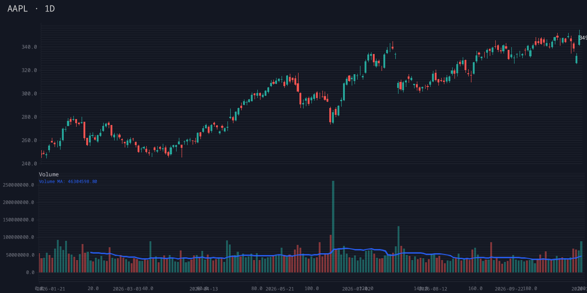

### `aroon`

Aroon Up/Down — bars since the highest high / lowest low over length+1 bars

**Parameters:**

| Param | Type | Default | Description |
|-------|------|---------|-------------|
| `length` | `integer` | `14` | Aroon length |

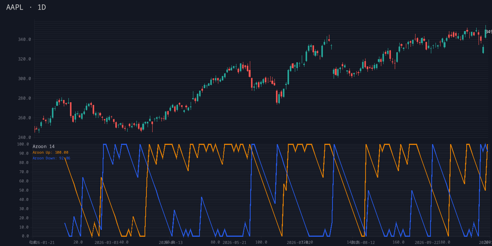

### `vortex`

Vortex Indicator — VI+ and VI- trend direction lines

**Parameters:**

| Param | Type | Default | Description |
|-------|------|---------|-------------|
| `length` | `integer` | `14` | Vortex length |

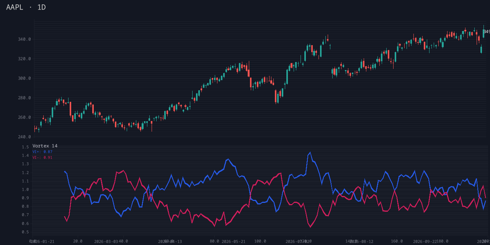

### `stoch_rsi`

Stochastic RSI (TradingView): ta.stoch of RSI, smoothed K and D (0-100)

**Aliases:** `stochrsi`

**Parameters:**

| Param | Type | Default | Description |
|-------|------|---------|-------------|
| `smooth_k` | `integer` | `3` | %K smoothing (SMA) |
| `smooth_d` | `integer` | `3` | %D smoothing (SMA of %K) |
| `rsi_length` | `integer` | `14` | RSI period |
| `stoch_length` | `integer` | `14` | Stochastic lookback applied to RSI |

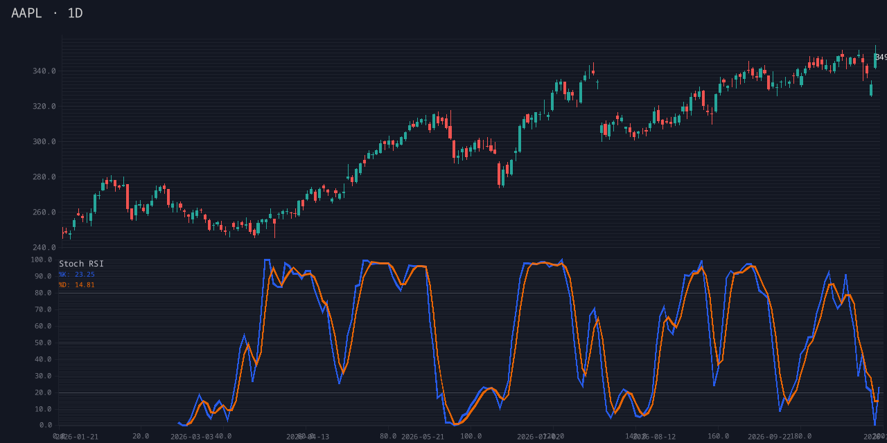

### `awesome_oscillator`

Awesome Oscillator: SMA(hl2,5) - SMA(hl2,34) histogram, green when rising

**Aliases:** `ao`

**Parameters:**

| Param | Type | Default | Description |
|-------|------|---------|-------------|
| `fast` | `integer` | `5` | Fast SMA of hl2 |
| `slow` | `integer` | `34` | Slow SMA of hl2 |

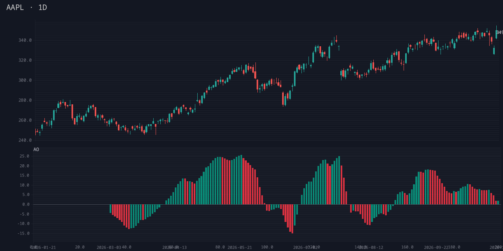

### `momentum`

Momentum: close - close[length]

**Aliases:** `mom`

**Parameters:**

| Param | Type | Default | Description |
|-------|------|---------|-------------|
| `length` | `integer` | `10` | Bars back |

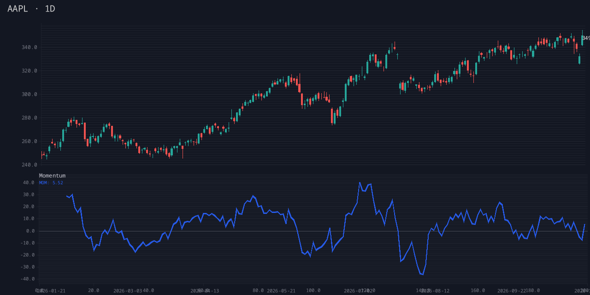

### `trix`

TRIX: 10000 * change of triple-smoothed EMA of log(close)

**Parameters:**

| Param | Type | Default | Description |
|-------|------|---------|-------------|
| `length` | `integer` | `18` | EMA length (applied three times) |

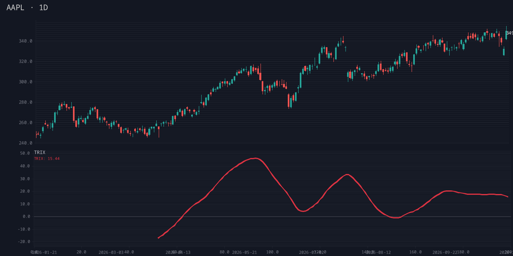

### `ultimate_oscillator`

Ultimate Oscillator (Larry Williams): weighted 7/14/28 buying-pressure ratios (0-100)

**Aliases:** `uo`

**Parameters:**

| Param | Type | Default | Description |
|-------|------|---------|-------------|
| `fast` | `integer` | `7` | Fast length |
| `middle` | `integer` | `14` | Middle length |
| `slow` | `integer` | `28` | Slow length |

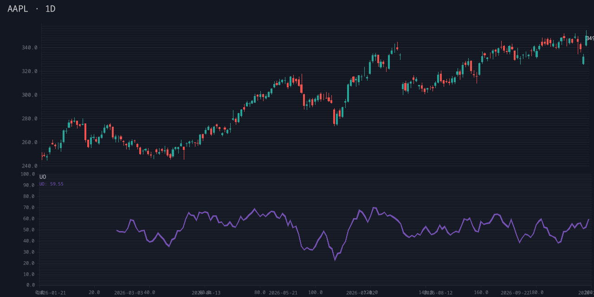

### `ppo`

Price Oscillator (TradingView): (short MA - long MA) / long MA * 100, MA type ema or sma

**Aliases:** `price_oscillator`

**Parameters:**

| Param | Type | Default | Description |
|-------|------|---------|-------------|
| `short` | `integer` | `10` | Short moving-average length |
| `long` | `integer` | `21` | Long moving-average length |
| `type` | `string` | `ema` | Moving average type |

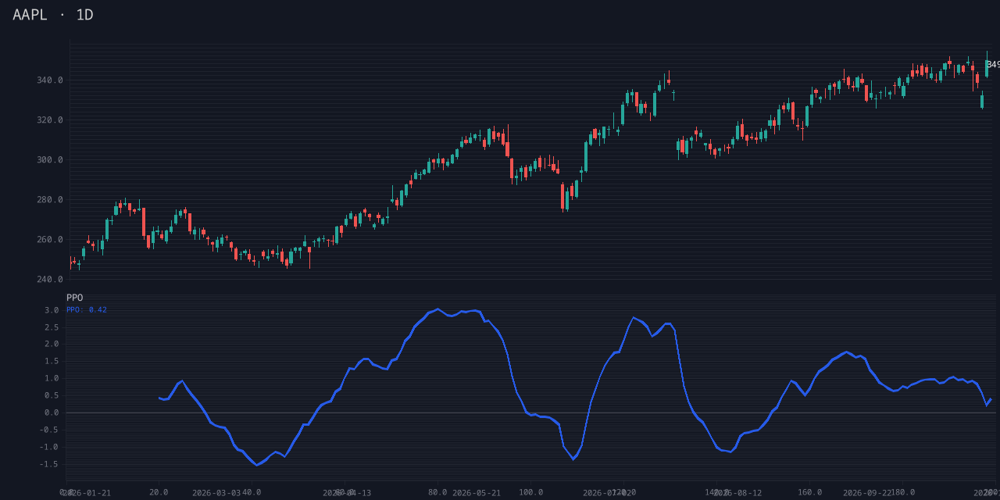

### `cmo`

Chande Momentum Oscillator (-100 to 100)

**Parameters:**

| Param | Type | Default | Description |
|-------|------|---------|-------------|
| `length` | `integer` | `9` | Lookback |


### `dpo`

Detrended Price Oscillator: close - SMA shifted back length/2+1 bars

**Parameters:**

| Param | Type | Default | Description |
|-------|------|---------|-------------|
| `length` | `integer` | `21` | SMA length |


### `elder_force_index`

Elder Force Index: EMA of change(close) * volume

**Aliases:** `efi`

**Parameters:**

| Param | Type | Default | Description |
|-------|------|---------|-------------|
| `length` | `integer` | `13` | EMA length |


### `tsi`

True Strength Index: double-smoothed momentum ratio (x100) with signal

**Parameters:**

| Param | Type | Default | Description |
|-------|------|---------|-------------|
| `long` | `integer` | `25` | Long (first) smoothing |
| `short` | `integer` | `13` | Short (second) smoothing |
| `signal` | `integer` | `13` | Signal EMA length |


### `kst`

Know Sure Thing: weighted sum of four smoothed rates of change, with signal

**Parameters:**

| Param | Type | Default | Description |
|-------|------|---------|-------------|
| `roc1` | `integer` | `10` | ROC length 1 |
| `roc2` | `integer` | `15` | ROC length 2 |
| `roc3` | `integer` | `20` | ROC length 3 |
| `roc4` | `integer` | `30` | ROC length 4 |
| `sma1` | `integer` | `10` | SMA length 1 |
| `sma2` | `integer` | `10` | SMA length 2 |
| `sma3` | `integer` | `10` | SMA length 3 |
| `sma4` | `integer` | `15` | SMA length 4 |
| `signal` | `integer` | `9` | Signal SMA length |


### `coppock`

Coppock Curve: WMA of ROC(long) + ROC(short)

**Aliases:** `coppock_curve`

**Parameters:**

| Param | Type | Default | Description |
|-------|------|---------|-------------|
| `wma_length` | `integer` | `10` | WMA length |
| `long_roc` | `integer` | `14` | Long ROC length |
| `short_roc` | `integer` | `11` | Short ROC length |


### `mass_index`

Mass Index: rolling sum of EMA(high-low,9) / EMA(EMA(high-low,9),9)

**Aliases:** `mi`

**Parameters:**

| Param | Type | Default | Description |
|-------|------|---------|-------------|
| `length` | `integer` | `10` | Summation length |


### `bb_percent_b`

Bollinger %B: (close - lower) / (upper - lower)

**Aliases:** `percent_b`, `bbp`

**Parameters:**

| Param | Type | Default | Description |
|-------|------|---------|-------------|
| `length` | `integer` | `20` | SMA / stdev length |
| `mult` | `number` | `2.0` | Standard deviation multiplier |


### `bb_width`

Bollinger Bands Width: 100 * (upper - lower) / basis, with Highest Expansion and Lowest Contraction

**Aliases:** `bbw`, `bandwidth`

**Parameters:**

| Param | Type | Default | Description |
|-------|------|---------|-------------|
| `length` | `integer` | `20` | SMA / stdev length |
| `mult` | `number` | `2.0` | Standard deviation multiplier |
| `highest_expansion` | `integer` | `125` | Highest Expansion lookback |
| `lowest_contraction` | `integer` | `125` | Lowest Contraction lookback |


### `choppiness`

Choppiness Index (0-100): high = sideways, low = trending

**Aliases:** `chop`

**Parameters:**

| Param | Type | Default | Description |
|-------|------|---------|-------------|
| `length` | `integer` | `14` | Lookback |


### `fisher_transform`

Fisher Transform of hl2 with trigger line

**Aliases:** `fisher`

**Parameters:**

| Param | Type | Default | Description |
|-------|------|---------|-------------|
| `length` | `integer` | `9` | Highest/lowest lookback of hl2 |


### `ease_of_movement`

Ease of Movement: SMA of 10000 * change(hl2) * (high-low) / volume

**Aliases:** `eom`

**Parameters:**

| Param | Type | Default | Description |
|-------|------|---------|-------------|
| `length` | `integer` | `14` | SMA length |
| `divisor` | `integer` | `10000` | Scaling divisor |


### `volume_oscillator`

Volume Oscillator: 100 * (EMA fast vol - EMA slow vol) / EMA slow vol

**Aliases:** `vol_osc`

**Parameters:**

| Param | Type | Default | Description |
|-------|------|---------|-------------|
| `short` | `integer` | `5` | Short volume EMA |
| `long` | `integer` | `10` | Long volume EMA |


### `balance_of_power`

Balance of Power: (close - open) / (high - low)

**Aliases:** `bop`


### `rvi`

Relative Vigor Index: SWMA(close-open) / SWMA(high-low) sums, with signal

**Aliases:** `relative_vigor_index`

**Parameters:**

| Param | Type | Default | Description |
|-------|------|---------|-------------|
| `length` | `integer` | `10` | Summation length |


### `smi_ergodic`

SMI Ergodic Indicator: ta.tsi ratio with signal and oscillator histogram

**Aliases:** `smi`

**Parameters:**

| Param | Type | Default | Description |
|-------|------|---------|-------------|
| `long` | `integer` | `20` | Long (first) smoothing |
| `short` | `integer` | `5` | Short (second) smoothing |
| `signal` | `integer` | `5` | Signal EMA length |


### `connors_rsi`

Connors RSI: average of RSI, streak RSI and percent rank of ROC(1) (0-100)

**Aliases:** `crsi`, `connors`

**Parameters:**

| Param | Type | Default | Description |
|-------|------|---------|-------------|
| `rsi_length` | `integer` | `3` | RSI length |
| `updown_length` | `integer` | `2` | Streak RSI length |
| `roc_length` | `integer` | `100` | Percent-rank lookback |


## External

### Summary

| Name | Aliases |
|------|---------|
| [`cvd`](#cvd) |  |
| [`funding`](#funding) | `funding_rate` |
| [`oi`](#oi) | `open_interest` |
| [`long_short`](#long_short) | `ls_ratio` |
| [`fear_greed`](#fear_greed) | `fng` |

### `cvd`

Cumulative Volume Delta — buy vs sell pressure


### `funding`

Funding Rate — crypto perpetual futures funding (Binance)

**Aliases:** `funding_rate`


### `oi`

Open Interest — total outstanding futures contracts (Binance)

**Aliases:** `open_interest`


### `long_short`

Long/Short Ratio — account positioning (Binance)

**Aliases:** `ls_ratio`


### `fear_greed`

Fear & Greed Index — market sentiment (alternative.me)

**Aliases:** `fng`


## Parameter examples (MCP)

```json
{"name": "rsi", "length": 21}
{"name": "bbands", "length": 30, "mult": 2.5}
{"name": "volume_profile", "bins": 32, "side": "right"}
```

Call the `list_indicators` MCP tool for the authoritative list with each
indicator's description, default parameters, and category at runtime.
